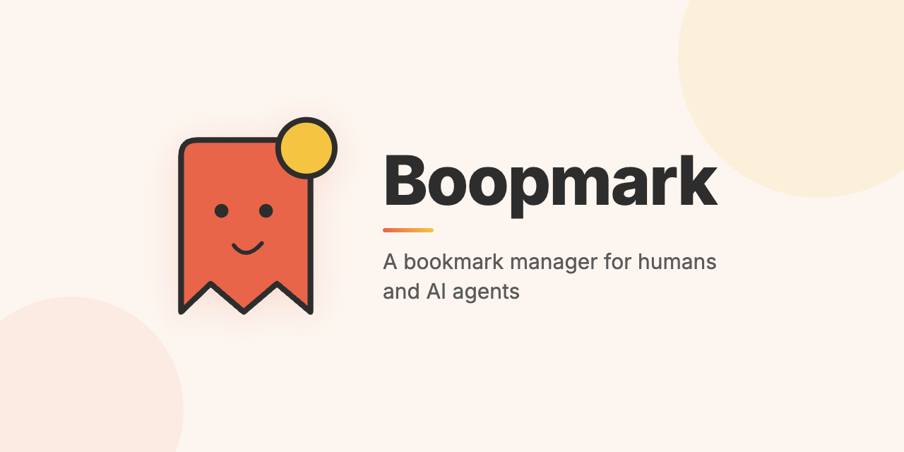

<p align="center">
  
</p>

<p align="center">
  <strong>A fast, self-hostable bookmark manager for humans and AI agents.</strong>
</p>

<p align="center">
  <a href="LICENSE"></a>
  <a href="https://github.com/willisrocks/boopmark/releases"></a>
  <a href="https://github.com/willisrocks/boopmark"></a>
</p>

<p align="center">
  Built with Rust, HTMX, and Tailwind CSS. Save, tag, and search your bookmarks from a clean web UI, a CLI (<code>boop</code>), or let your AI coding agents do it for you. Optional AI enrichment auto-generates tags and descriptions. Pluggable screenshot capture for page thumbnails.
</p>

---

## Installation

### For humans

The official clients connect to `https://boopmark.com` or your own HTTPS Boopmark server. Before connecting, sign in to the web app and create an API key under **Settings → API keys**.

#### Chrome extension

1. Open [Boopmark in the Chrome Web Store](https://chromewebstore.google.com/detail/boopmark/oncfakjpmbjhmahhccdboahbhgjihgbo) in Chrome 127 or later and select **Add to Chrome**.
2. Optionally pin Boopmark from Chrome's Extensions menu for one-click access.
3. Select the Boopmark toolbar icon, enter your server URL and API key, and grant access to that server when Chrome asks.
4. On any page you want to save, select the toolbar icon, review the captured or AI-suggested metadata, and select **Add Bookmark**.

#### iPhone app

1. Install [Boopmark from the App Store](https://apps.apple.com/app/boopmark/id6805968959). The app requires iOS 16 or later.
2. Open Boopmark, enter your server URL and API key in **Settings**, then select **Save connection**.
3. To save a page from Safari or another app, open its Share Sheet and select **Boopmark**. If Boopmark is not shown, enable it from the Share Sheet's **More** or **Edit Actions** screen.

For self-hosting or CLI setup, tell your AI coding agent:

> Read https://raw.githubusercontent.com/willisrocks/boopmark/main/README.md and follow the installation instructions.

Or follow the [Quick Start](#quick-start-self-hosting) and [CLI](#cli-boop) sections below.

### For AI agents

#### Claude Code plugin

Install the Boopmark plugin to give Claude Code the `boop` skill:

```bash
claude plugin add willisrocks/boopmark
```

This adds the `boop` skill, which Claude Code will automatically use when you ask about bookmarks.

#### CLI setup (all agents)

Any AI agent with shell access can use the `boop` CLI directly:

```bash
# 1. Install the binary
curl -fsSL https://raw.githubusercontent.com/willisrocks/boopmark/main/install.sh | sh

# 2. Point at your Boopmark server (local or hosted)
boop config set-server http://localhost:4000          # local dev
# or
boop config set-server https://boopmark.yourdomain.com  # your hosted instance

# 3. Get your API key: log in to the Boopmark web app → Settings → Generate API Key
boop config set-key YOUR_API_KEY

# 4. Verify
boop list
```

> **Important:** You need a running Boopmark server and a user account before the CLI will work. See [Quick Start](#quick-start-self-hosting) to set one up, then log in to the web app to generate your API key under **Settings**.

To give Claude Code (or any AI agent) access without the plugin, add this to your project's `CLAUDE.md` or `AGENTS.md`:

```markdown
## Bookmarks

Use the `boop` CLI to save and search bookmarks:
- `boop add <url> --tags "tag1,tag2"` — save a bookmark
- `boop search <query>` — find bookmarks
- `boop list` — list recent bookmarks
- `boop add <url> --suggest` — save with AI-suggested tags and description
```

## Features

- Save and tag bookmarks with automatic metadata extraction
- Full-text search across titles, descriptions, and URLs
- AI enrichment via Anthropic Claude (auto-tagging, descriptions)
- Chrome extension and native iPhone app with a Share Extension
- CLI client (`boop`) for terminal and agent-based bookmark management
- Claude Code skill support — agents can save and search bookmarks
- Optional screenshot capture via Playwright sidecar
- Invite-only access control with admin panel
- Import/export (JSONL, CSV, Netscape HTML)
- S3-compatible image storage (local disk or RustFS/AWS S3/R2)

## Quick Start (Self-Hosting)

The fastest path uses Docker Compose and `just bootstrap`:

```bash
# 1. Prerequisites: Docker, just, openssl
git clone https://github.com/chrisfenton/boopmark
cd boopmark

# 2. Bootstrap: generates secrets, starts services, creates your owner account
just bootstrap you@example.com --password yourpassword

# 3. Open http://localhost:4000 and sign in
```

`just bootstrap` copies `.env.example` to `.env`, generates random secrets, starts the Docker stack, waits for readiness, and creates your owner account in one step.

## Configuration

Copy `.env.example` to `.env` and customize. Only three variables are required; everything else has sensible defaults.

| Variable | Default | Description |
|----------|---------|-------------|
| `DATABASE_URL` | — | Postgres connection string (required) |
| `SESSION_SECRET` | — | Random hex string for session signing (required) |
| `LLM_SETTINGS_ENCRYPTION_KEY` | — | Base64-encoded 32-byte key for encrypting API keys (required) |
| `APP_URL` | `http://localhost:4000` | Public base URL |
| `PORT` | `4000` | HTTP port |
| `LOGIN_ADAPTER` | `local_password` | `local_password` or `google` |
| `GOOGLE_CLIENT_ID` | — | Required when `LOGIN_ADAPTER=google` |
| `GOOGLE_CLIENT_SECRET` | — | Required when `LOGIN_ADAPTER=google` |
| `STORAGE_BACKEND` | `local` | `local` or `s3` |
| `S3_ENDPOINT` | — | S3-compatible endpoint URL |
| `S3_ACCESS_KEY` | — | S3 access key |
| `S3_SECRET_KEY` | — | S3 secret key |
| `S3_REGION` | `auto` | S3 region |
| `S3_IMAGES_BUCKET` | `boopmark-images` | S3 bucket name |
| `S3_IMAGES_PUBLIC_URL` | — | Public URL prefix for stored images |
| `SCREENSHOT_BACKEND` | `disabled` | `disabled` or `playwright` |
| `SCREENSHOT_SERVICE_URL` | — | Required when `SCREENSHOT_BACKEND=playwright` |
| `METADATA_FALLBACK_BACKEND` | — | `opengraph_io` (optional) |
| `OPENGRAPH_IO_API_KEY` | — | Required when `METADATA_FALLBACK_BACKEND=opengraph_io` |
| `EMBEDDING_BACKEND` | `disabled` | `disabled`, `openai` or `local` (`local` needs a build with `--features local-embeddings`) |
| `EMBEDDING_MODEL` | `text-embedding-3-large` | Embedding model; `BAAI/bge-small-en-v1.5` by default for `local` |
| `EMBEDDING_DIMENSIONS` | `1024` | Vector size for `openai` (default model only; otherwise the model's native size) |
| `OPENAI_EMBEDDING_API_KEY` | — | Operator key, required when `EMBEDDING_BACKEND=openai` |
| `ORT_DYLIB_PATH` | — | `local` only: path of the ONNX Runtime library (`libonnxruntime.so`), loaded at startup |
| `FASTEMBED_CACHE_DIR` | fastembed's default | `local` only: where the model is downloaded on first start |
| `ANTHROPIC_EFFORT` | `low` | Anthropic `effort` for models that accept it: `low`, `medium`, `high`, `xhigh`, `max` or `none` |
| `LLM_BACKEND` | — | `llamacpp` sends every LLM request to `LLAMACPP_BASE_URL` (local development) |
| `ARTICLE_INGEST_ENABLED` | `1` | Fetch the article text of saved pages in the background for search. `0` stops fetching: new bookmarks are searched by their metadata, and article text that was already stored stays searchable |
| `ARTICLE_INGEST_CONCURRENCY` | `4` | Article fetches in parallel (at most one per host per second) |
| `PAGE_CAPTURE_ENABLED` | `1` | Accept page HTML from the browser extension (`PUT /api/v1/bookmarks/{id}/page`). `0` answers that route with `404`, for self-hosters who do not want that write surface |
| `PAGE_CAPTURE_MAX_BYTES` | `5242880` | Cap on the gzipped capture body, and on the HTML it inflates to |
| `PAGE_SCRAPER` | `disabled` | Server-side fallback for URL-only saves: `disabled` or `firecrawl`. Only consulted when the direct fetch fails, returns under 300 characters, or gets a member-only preview |
| `PAGE_SCRAPER_API_KEY` | — | Firecrawl key (operator account). `PAGE_SCRAPER=firecrawl` without it logs a warning and stays disabled |
| `PAGE_SCRAPER_TIMEOUT_SECONDS` | `30` | One scrape's timeout, retries excluded. Capped at `45` with a warning at startup: a longer scrape cannot finish inside an ingest job's budget (which must also cover the extraction), and a timed-out job still pays for the page |
| `PAGE_SCRAPER_MONTHLY_BUDGET_PAGES` | `0` | Pages per calendar month; `0` is no cap. Past it, no scrape is attempted until the next month |
| `PAGE_SCRAPER_CONCURRENCY` | `2` | Scrapes in flight, at most `10`. The vendor's plan renders only a few pages at once and answers a burst above its limit with `429`, so a job waits for a free slot and keeps its direct result if none comes in time |
| `PAGE_SCRAPER_RATE_PER_MINUTE` | `10` | Vendor requests a minute, at most `600`. The plan limits requests a minute as well as renders in flight, so a job also waits for its turn before a page is reserved. A `429` pauses every scrape for the wait the vendor named (`Retry-After`, capped at 120 s) |
| `ENABLE_E2E_AUTH` | `0` | Set to `1` for E2E test auth bypass |
| `RUST_LOG` | `info` | Log filter ([`EnvFilter`](https://docs.rs/tracing-subscriber/latest/tracing_subscriber/filter/struct.EnvFilter.html) syntax). Unset, the server logs at `info`, which includes the ingest and page-scraper failure lines |

## Deployment Guides

### Search

Search ranks bookmarks by their title, description, tags and the text of the saved page, which a background worker fetches. With `EMBEDDING_BACKEND=openai` (or `local`) it also searches by meaning: each article is split into passages that are embedded, and the worker embeds a failed page's title, description, URL and tags instead. Turning embeddings on, or changing the model, embeds the existing library in the background (rate-limited, resumable); until a bookmark is embedded it is found by its words. Settings → Search index shows the progress and retries failed fetches.

The Postgres server needs pgvector ≥ 0.8 (`docker-compose.yml` uses `pgvector/pgvector:pg16`). The release image is built without `local-embeddings`; a self-hoster who wants free local embeddings builds with `cargo build --release --features local-embeddings`, installs ONNX Runtime, sets `ORT_DYLIB_PATH`, and gives the VM at least 1 GB. (A published local-embeddings image is a follow-up.)

### Docker Compose (default)

```bash
just bootstrap you@example.com --password yourpassword
```

The server runs on port 4000. Add a reverse proxy (nginx, Caddy) for HTTPS.

### Fly.io

The committed `fly.toml` is a working starting point: app `boopmark`, internal port 4000, an HTTP check on `/health`, and one always-on 512 MB machine. Rename `app` to your own Fly app name, or generate the config yourself with `fly launch --no-deploy` and keep the port (`4000`) and `/health` check.

1. **Postgres.** Create a Fly Managed Postgres cluster with `fly mpg create`, then attach it with `fly mpg attach <cluster-id> -a <your-app>` — that sets the `DATABASE_URL` secret for you. Any other Postgres URL works too: `fly secrets set DATABASE_URL='postgres://...'`. Search needs the `pg_trgm` and `vector` (pgvector ≥ 0.8) extensions: on Fly MPG, enable both in the cluster's dashboard before the first deploy (migrations 016 and 018 create them elsewhere). Settings → Search index shows the owner the installed versions.

2. **Required configuration.** Variable names only; the values are yours to generate and none belong in git:

   ```bash
   fly secrets set \
     SESSION_SECRET="$(openssl rand -hex 32)" \
     LLM_SETTINGS_ENCRYPTION_KEY="$(openssl rand -base64 32)" \
     APP_URL="https://your-app.fly.dev"
   ```

3. **Deploy from source.** `fly deploy` builds the Dockerfile and rolls a new machine; the server migrates on startup.

4. **Or deploy a release image.** To run a published build instead of building locally, use the versioned GHCR image:

   ```bash
   fly deploy --image ghcr.io/willisrocks/boopmark:0.8.2
   ```

   Pick the version from [Releases](https://github.com/willisrocks/boopmark/releases); every release publishes `ghcr.io/willisrocks/boopmark:X.Y.Z`.

5. **Create the first owner.** The image ships the `hash_password` helper. Hash a password inside the machine, then insert the result with psql:

   ```bash
   fly ssh console -a your-app        # inside: echo '<password>' | ./hash_password
   fly mpg connect <cluster-id>       # psql against the attached cluster
   ```

   ```sql
   INSERT INTO users (email, name, password_hash, role)
   VALUES ('you@example.com', 'You', '<hash>', 'owner');
   ```

   With any other Postgres, use your own client against `DATABASE_URL`.

6. **Custom domain and TLS.** `fly certs add boopmark.yourdomain.com` prints the DNS records to create, and `fly certs show boopmark.yourdomain.com` reports certificate status. Once the certificate is issued, point `APP_URL` at the public URL (`fly secrets set APP_URL='https://boopmark.yourdomain.com'` restarts the machine).

7. **Image storage.** With `STORAGE_BACKEND=local`, uploads land on the machine's ephemeral disk and are lost on redeploy. For a real instance set `STORAGE_BACKEND=s3` plus the `S3_*` variables (RustFS, AWS S3, or Cloudflare R2).

### Optional: S3 Storage (RustFS)

Uncomment the `rustfs` service in `docker-compose.yml`, then set:
```
STORAGE_BACKEND=s3
S3_ENDPOINT=http://rustfs:9000
S3_ACCESS_KEY=rustfsadmin
S3_SECRET_KEY=rustfsadmin
```

### Optional: Screenshot Capture

Uncomment the `screenshot-svc` service in `docker-compose.yml`, then set:
```
SCREENSHOT_BACKEND=playwright
SCREENSHOT_SERVICE_URL=http://screenshot-svc:3001
```

The service only loads public `http`/`https` URLs on ports 80, 443, 8080 and 8443. Every browser request, redirects and subresources included, goes through a built-in proxy that refuses hosts resolving to private, loopback, link-local or other non-public addresses. Pages hosted on your own network cannot be captured. Run its tests with `node --test screenshot-svc/test`.

## CLI (`boop`)

```bash
# Install
curl -fsSL https://raw.githubusercontent.com/chrisfenton/boopmark/main/install.sh | sh

# Configure
boop config set-server https://your-boopmark-instance.example.com
boop config set-key YOUR_API_KEY

# Use
boop add https://example.com --title "Example" --tags "ref,tools"
boop list
boop search "rust async"
boop export --format jsonl > backup.jsonl
```

See `boop --help` for all commands.

## Development

**Prerequisites:** Rust (stable), Node.js 24+, Docker, [just](https://github.com/casey/just)

```bash
# One-time setup (starts db, runs migrations, installs deps, builds CSS)
just setup

# Start the server
cargo run -p boopmark-server

# Watch CSS changes
just css

# Run tests
cargo test

# Run linter
cargo clippy -- -D warnings
```

For local HTTPS subdomains, install [devproxy](https://github.com/foundra-build/devproxy) and set `USE_DEVPROXY=1` in `.env`, then run `just dev`.

## Architecture

Boopmark follows hexagonal (ports-and-adapters) architecture:

- **Domain** (`server/src/domain/`) — pure business logic, no I/O
- **Ports** (`server/src/domain/ports/`) — trait definitions for external dependencies
- **Adapters** (`server/src/adapters/`) — concrete implementations (Postgres, S3, Anthropic, etc.)
- **App services** (`server/src/app/`) — orchestration layer
- **Web** (`server/src/web/`) — Axum handlers, templates, routing

Key ports: `BookmarkRepository`, `MetadataExtractor`, `ObjectStorage`, `LlmEnricher`, `LoginProvider`, `ScreenshotProvider`

See [CONTRIBUTING.md](CONTRIBUTING.md) for details on adding new adapters.

## Contributing

See [CONTRIBUTING.md](CONTRIBUTING.md).

## License

MIT — see [LICENSE](LICENSE).

