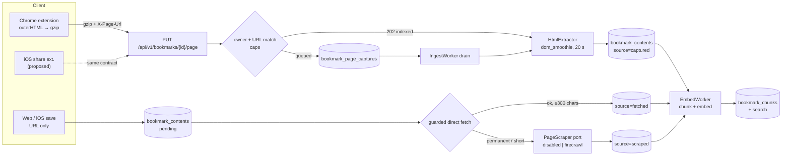

# Page Capture for Unfetchable Articles — Design

**Status:** Draft (spec; no code)
**Date:** 2026-11-03
**Issue:** [#51](https://github.com/willisrocks/boopmark/issues/51) — "Ingest: 43 medium.com articles (82 total) can't be fetched"
**Depends on:** [`2026-10-31-hybrid-article-search-design.md`](2026-10-31-hybrid-article-search-design.md) (open question 5), migrations 016 and 018 as shipped
**Companion:** the scraper evaluation is a separate task; its measurements live in `docs/superpowers/specs/assets/2026-11-03-scraper-eval.md`

## Summary

82 of 340 production bookmarks have no article text; the server's fetch is blocked
(Cloudflare, bot checks) or lands on a paywall teaser. The bookmark stays findable by
title, description, URL and tags, but its body is not searchable.

Three paths close the gap, in order of reach:

1. **The browser captures the page.** The Chrome extension reads
   `document.documentElement.outerHTML` from the tab it is already allowed to touch,
   gzips it, and `PUT`s it to the server together with the save (or on demand for an
   existing bookmark). The server runs the *existing* `dom_smoothie` Readability parse on
   it and stores the text through the existing chunk + embed pipeline. No LLM, no
   server-side fetch of the page, no cookies.
2. **A server-side scraper as a fallback** for URL-only saves (web paste, iOS share from
   a non-Safari app). A new `PageScraper` port sits behind the existing `ArticleFetcher`
   as a decorator: it is consulted only when the guarded direct fetch fails or returns no
   article. The companion eval chose Firecrawl (hosted); Obscura was dropped.
3. **The iOS Safari share extension** returns the page HTML through
   `NSExtensionJavaScriptPreprocessingFile` and `PUT`s it the same way. This is an
   optional proposal, not a commitment.

The stored text gains a `source` (`fetched` | `captured` | `scraped`), Settings → Search
index reports the counts per source, and one migration (019) carries all schema changes.

## Problem

The production index after v0.9.0 (issue #51):

| domain | bookmarks without text |
|---|---|
| medium.com | 43 |
| generativeai.pub | 5 |
| agentnativedev.medium.com | 3 |
| levelup.gitconnected.com | 3 |
| builders.ramp.com | 2 |
| **total** | **82 of 340** |

Medium and Medium-hosted publications dominate, and they block datacenter IPs and serve
challenge pages. The hybrid-search spec already decided to index the metadata fallback
(measured: failed-link queries 0.061 → 0.918) and left the body of those pages as open
question 5.

The body of the article is already on the user's screen when they save the link. The
browser can hand it over; nothing about the page is secret, and no credential is
involved.

## Goals

- A saved page whose server fetch fails can still have its body indexed, with the text
  coming from the browser that displayed it.
- The captured text is searchable within seconds of the save, by the existing lexical
  leg, and embedded by the existing worker.
- URL-only saves get a second chance without any client change, behind a port that is
  off by default.
- One interface, fixed now, so the server and extension work can proceed in parallel.

## Non-goals

- **Stored cookies, passwords, paid-site sessions, or paywall bypass.** The browser sends
  what it rendered for a public page. A paywall teaser stays a teaser.
- LLM extraction, summarisation or prompts on the captured HTML. `dom_smoothie` only.
- Fetching subresources (images, CSS, fonts, scripts, iframes) from the captured HTML.
- Archiving the HTML. Only the extracted text is stored, and only for the moment it takes
  to parse in the rare queued case.
- Screenshots as an OCR source; the `SCREENSHOT_BACKEND` pipeline is unchanged.
- Changing the metadata/enrichment path or `/suggest`.
- A new client other than the Chrome extension. iOS is proposed, not built here.

## Constraints fixed before this design (owner decisions)

These are inputs, not open questions:

- No stored cookies, passwords or site sessions; do not design for them.
- Primary path is the browser capture described above, with the fixed HTTP interface in
  [HTTP interface](#http-interface-put-apiv1bookmarksidpage).
- `dom_smoothie` Readability on the server; no LLM extraction.
- URL match required; ~5 MB cap in both directions; parse only, never fetch subresources;
  keep the existing extraction timeout.
- Captured text wins over a later *failed* server fetch.
- Server-side scraper only as a fallback for URL-only saves, behind a `PageScraper` port
  with a disabled adapter and env configuration. The adapter is Firecrawl, chosen by the
  eval.
- iOS Safari share extension: propose only.

## Brainstorming decisions (auto-pilot)

The superpowers brainstorming skill is not installed on this host (same as the
tag-management spec). I ran its question loop myself and answered each question from code,
existing behaviour or the owner's fixed decisions; there was no human gate. Each row names
the section that carries the consequence.

| Question | Answer | Evidence |
|---|---|---|
| Where is the captured HTML parsed: in the request, in the ingest worker, or a new queue? | In the request, on the existing bounded blocking pool. The interface's `422` ("readability found no article") can only be returned if the parse happens before the response. | `readability.rs:149-174` `run_bounded`; `EXTRACT_TIMEOUT` 20 s (`:28`) |
| What happens when the parse does not fit the request's budget? | The HTML is stored in `bookmark_page_captures` and the response says `{"status":"queued"}`; the ingest worker parses it on its next loop. | Interface allows `queued`; avoids inventing a status |
| Do we store the HTML or only the text? | Text only, in `bookmark_contents.text`. The HTML is kept solely for the queued case, deleted as soon as it is parsed. | `store_article` writes text; 5 MB × N in a text column would be new weight |
| New table for captured text, or a column? | A `source` column on `bookmark_contents`; no second content table. | One row per bookmark already (`bookmark_id` PK, `016:22`) |
| Who fetches for URL-only saves? | A decorator on `ArticleFetcher`, so `IngestWorker` is untouched and a disabled scraper is a no-op. | `IngestWorker::process` calls only `ArticleFetcher::fetch` (`app/ingest.rs:128`) |
| Which direct-fetch outcomes call the scraper? | A member-only preview, `Permanent` failures, and successes whose text is shorter than 300 chars. Not `Transient` (the retry schedule already covers them) and not `Skipped` (not an HTML page). | `failure_for` (`app/ingest.rs:30`); `MIN_CHUNKED_TEXT_CHARS = 300` (`domain/chunking.rs:22`); eval recommendation 3 |
| How is "captured wins" enforced: a rank column or the queue? | The queue. A captured row is `fetched`, so the worker never claims it; a capture clears `claim_token`, so an in-flight fetch's result is dropped by its own guard. No rank arithmetic. | `store_article` requires `status='pending' AND claim_token=$3` (`search_repo.rs:414-434`) |
| Do we need a persisted normalized-URL column for the lookup and the match? | No. One Rust function normalizes both sides; the lookup is bounded to one user and one origin. | `find_by_url` is exact-match today (`bookmark_repo.rs:304`) |
| Where does the scraper budget live: memory or the database? | The database, per calendar month, so a restart cannot reset the spend. | In-memory counters do not survive deploys |
| Does the PUT need idempotency keys? | No. A re-capture overwrites; unchanged text keeps the chunks via `content_hash`. | `store_article` already keys re-embedding on `content_hash` |
| Which Chrome permission reads the DOM? | `scripting`, used only inside a popup invocation that already holds `activeTab`. | The extension spec forbids persistent host access; `manifest.json` has `activeTab`, `storage` |
| Is the extension's 2026-08-27 privacy statement still true? | No. It says "no page DOM" is transmitted. This design amends that statement; the user is told the page text is sent. | `2026-08-27-chrome-extension-design.md`, Permissions and privacy |
| Is capture tied to `ARTICLE_INGEST_ENABLED`? | No. Capture is a user action and works with fetching disabled; only embedding is optional. | Config flag only gates the worker (`main.rs:232`) |
| Migration number? | `019`, the next free after `018_bookmark_chunks_vector.sql`. | `migrations/` |

## Design



Everything below the HTTP interface already exists; the new code is the route, the
extractor seam, the `source` column, the queue drain, the scraper port and its decorator.

### Configuration

Added to `Config` (`server/src/config.rs`), parsed like the existing backend enums
(`SCREENSHOT_BACKEND`, `METADATA_FALLBACK_BACKEND`):

```
PAGE_CAPTURE_ENABLED=1                 # default 1; 0 rejects the PUT with 404
PAGE_CAPTURE_MAX_BYTES=5242880         # gzip body cap, and the decompressed cap
PAGE_SCRAPER=disabled                  # default disabled | firecrawl
PAGE_SCRAPER_API_KEY=                  # firecrawl only; the operator's key
PAGE_SCRAPER_TIMEOUT_SECONDS=30        # one scrape, retries excluded (at most 45)
PAGE_SCRAPER_MONTHLY_BUDGET_PAGES=0    # 0 = no cap; otherwise pages per calendar month
PAGE_SCRAPER_CONCURRENCY=2             # scrapes in flight, 2 by default (1..=10)
```

`PAGE_SCRAPER=firecrawl` without `PAGE_SCRAPER_API_KEY` logs a warning naming the variable
and runs the disabled scraper; it does not fail startup. The key is not deployed
everywhere yet, and an app that cannot boot without it could not be deployed at all. A
scrape is then refused before the vendor is called, exactly as with
`PAGE_SCRAPER=disabled`.

`PAGE_CAPTURE_ENABLED=0` exists for self-hosters who consider the endpoint a write
surface they do not want; it is on by default because the feature is useless otherwise.

### Data model (migration `019_page_capture.sql`)

One migration, four statements, no backfill beyond a single `UPDATE`.

```sql
-- 1. Where the stored text came from. NULL when no article text is stored.
ALTER TABLE bookmark_contents
    ADD COLUMN source TEXT CHECK (source IN ('fetched', 'captured', 'scraped'));
UPDATE bookmark_contents SET source = 'fetched'
    WHERE status = 'fetched' AND text IS NOT NULL;
CREATE INDEX idx_bookmark_contents_source ON bookmark_contents(user_id, source)
    WHERE status = 'fetched';

-- 2. Captured HTML accepted but not yet parsed (the rare `queued` answer).
--    One row per bookmark: a re-capture replaces the pending payload.
CREATE TABLE bookmark_page_captures (
    bookmark_id UUID PRIMARY KEY REFERENCES bookmarks(id) ON DELETE CASCADE,
    user_id     UUID NOT NULL REFERENCES users(id) ON DELETE CASCADE,
    page_url    TEXT NOT NULL,          -- X-Page-Url after validation
    html_gz     BYTEA NOT NULL,         -- gzip, ≤ PAGE_CAPTURE_MAX_BYTES
    created_at  TIMESTAMPTZ NOT NULL DEFAULT now()
);
CREATE INDEX idx_bookmark_page_captures_age ON bookmark_page_captures(created_at);

-- 3. Scraper spend, one row per calendar month, survives restarts.
CREATE TABLE scraper_usage (
    month      DATE PRIMARY KEY,        -- first day of the month, UTC
    pages      BIGINT NOT NULL DEFAULT 0,
    failures   BIGINT NOT NULL DEFAULT 0,
    updated_at TIMESTAMPTZ NOT NULL DEFAULT now()
);

-- 4. The 018 trigger, plus `source = NULL` on a URL change: the old page's
--    captured text must not be attributed to the new URL.
CREATE OR REPLACE FUNCTION bookmarks_sync_content() RETURNS trigger
LANGUAGE plpgsql AS $$
BEGIN
    IF TG_OP = 'INSERT' OR NEW.url IS DISTINCT FROM OLD.url THEN
        INSERT INTO bookmark_contents (bookmark_id, user_id, search, meta_text)
        VALUES (NEW.id, NEW.user_id,
                bookmark_search_document(NEW.title, NEW.description, NEW.url, NEW.tags, NULL),
                concat_ws(' ', NEW.title, NEW.description))
        ON CONFLICT (bookmark_id) DO UPDATE SET
            status = 'pending', attempts = 0, next_attempt_at = now(), claim_token = NULL, error = NULL,
            text = NULL, text_chars = 0, content_hash = NULL, fetched_at = NULL, source = NULL,
            embedded_model = NULL, embed_attempts = 0, embed_next_attempt_at = now(), embed_error = NULL,
            search = EXCLUDED.search, meta_text = EXCLUDED.meta_text, updated_at = now();
        IF TG_OP = 'UPDATE' AND to_regclass('bookmark_chunks') IS NOT NULL THEN
            DELETE FROM bookmark_chunks WHERE bookmark_id = NEW.id;
        END IF;
        PERFORM pg_notify('bookmark_ingest', '');
    ELSE
        UPDATE bookmark_contents SET
            search = bookmark_search_document(NEW.title, NEW.description, NEW.url, NEW.tags, text),
            meta_text = concat_ws(' ', NEW.title, NEW.description),
            embedded_model = CASE
                WHEN (OLD.title, OLD.description) IS DISTINCT FROM (NEW.title, NEW.description)
                  OR (OLD.tags IS DISTINCT FROM NEW.tags AND text_chars < 300)
                THEN NULL ELSE embedded_model END,
            embed_attempts = 0, embed_next_attempt_at = now(),
            updated_at = now()
        WHERE bookmark_id = NEW.id;
    END IF;
    RETURN NULL;
END
$$;
```

The trigger body is the 018 version with exactly two edits: `source = NULL` in the
`ON CONFLICT` clause and a comment. The migration is additive; existing `fetched` rows
become `source = 'fetched'`.

`source` is deliberately **not** in the `search` tsvector: it is provenance, not prose.

### HTTP interface `PUT /api/v1/bookmarks/{id}/page`

Registered on the existing bookmarks router (`server/src/web/api/bookmarks.rs::routes`,
`:356`) as `/api/v1/bookmarks/{id}/page`. The path segment is the bookmark UUID.

**Request**

| Part | Value |
|---|---|
| Method / path | `PUT /api/v1/bookmarks/{id}/page` |
| Auth | `AuthUser`: `Authorization: Bearer <api key>` first, then the `session` cookie (existing extractor, `web/extractors.rs`) |
| Body | the page HTML, gzip-compressed, sent as the raw request body (no multipart, no JSON) |
| `Content-Type` | `text/html; charset=utf-8` (charset optional; other types are rejected) |
| `Content-Encoding` | `gzip` (required; identity is rejected — the extension always compresses) |
| `X-Page-Url` | the client's `location.href`, absolute |

**Responses**

| Status | Body | When |
|---|---|---|
| `202` | `{"status":"indexed"}` | text extracted and stored; the lexical leg finds it now |
| `202` | `{"status":"queued"}` | HTML accepted and stored; extraction is deferred to the ingest worker |
| `400` | `{"error":"invalid_page_url"}` | `X-Page-Url` missing, not absolute, or not http(s) |
| `400` | `{"error":"unsupported_content_type"}` | `Content-Type` is not `text/html`/`application/xhtml+xml` |
| `400` | `{"error":"unsupported_encoding"}` | `Content-Encoding` is missing or not `gzip` |
| `400` | `{"error":"bad_gzip"}` | the body is not gzip, is truncated, or decodes to zero bytes |
| `401` | *empty* | no/invalid credentials (existing `AuthUser` rejection) |
| `404` | `{"error":"not found"}` | no bookmark with that id for this user; also when `PAGE_CAPTURE_ENABLED=0` |
| `409` | `{"error":"url_mismatch"}` | `X-Page-Url` and the bookmark URL differ after [normalization](#url-normalization) |
| `413` | `{"error":"too large"}` | compressed or decompressed body over the cap |
| `422` | `{"error":"no readable article"}` | Readability parsed the page and found no article text |
| `503` | `{"error":"busy"}` | the capture queue is full (see [Limits](#limits-and-safety)); the client may retry later, and never automatically |

`401` comes from the existing `AuthUser` extractor and `503` is the one status outside the
brief's fixed list: it exists so that a full capture queue is not reported as
"no readable article". Both are handled by the extension's generic error path.

Error bodies use the existing `ErrorBody { error: String }` shape
(`api/bookmarks.rs:51`), not Problem Details. `404` for "not yours" and "missing" alike is
deliberate: it does not disclose other users' bookmark ids.

**Check order** (cheapest and least disclosing first):

1. `AuthUser` → `401`.
2. Load the bookmark with `BookmarkRepository::get(id, user.id)`; missing → `404`.
3. `X-Page-Url` parse + scheme check → `400 invalid_page_url`.
4. Normalize and compare with the bookmark URL → `409 url_mismatch`. (Done before reading
   the body: a mismatched page costs nothing.)
5. `Content-Length`, when present, over the cap → `413`.
6. Read the body as a **stream**, aborting past the compressed cap → `413`.
7. Gunzip as a stream, aborting past the decompressed cap → `413`; a decoder error, a
   trailing-garbage body, or zero output bytes → `400 bad_gzip`.
8. Extract (see below) → `422` or `202`.

**CSRF / same-origin.** The app has no CSRF token or middleware; its only existing rule is
the session cookie's `SameSite=Lax` (`web/pages/auth_shared.rs:31-38`), and the router
grants no CORS (`web/router.rs:40-59`; the `cors` feature is a dependency but no layer is
installed). This PUT is not a simple request — `PUT`, a non-safelisted content coding and
the `X-Page-Url` header all force a CORS preflight — so no cross-site page can send it,
and with `SameSite=Lax` a cross-site request would not carry the session anyway. The
extension sends `credentials: "omit"` and a Bearer key, so it never relies on the cookie
(`extensions/chrome/api.js`). No new CSRF mechanism is introduced; a test asserts that a
preflight from a foreign origin gets no `Access-Control-Allow-Origin`.

**Handler shape** (the parts that matter):

```rust
// server/src/web/api/page_capture.rs
async fn capture_page(
    State(state): State<AppState>,
    AuthUser(user): AuthUser,
    Path(id): Path<Uuid>,
    headers: HeaderMap,
    body: Body,
) -> Response
```

The body is taken as `axum::body::Body` and streamed, so axum's 2 MiB `DefaultBodyLimit`
(which applies to `Bytes` extractors) does not decide the cap; the caps above do.

### URL normalization

One function, `domain/url_match.rs::same_page(bookmark_url, page_url) -> bool`, used by the
`409` check and by the [lookup](#looking-up-an-existing-bookmark).

Both URLs are parsed with the `url` crate. Then:

| Part | Rule | Why |
|---|---|---|
| scheme | case-insensitive; `http` ≡ `https` | Saves are often stored pre-redirect; Medium serves `http` URLs that land on `https` |
| host | lowercased by the parser (IDNA/punycode applied); default port removed | parser behaviour; a non-default port must match |
| userinfo | must be absent in both | embedded credentials are already refused everywhere else in the app |
| path | one trailing `/` is ignored (`/a/` ≡ `/a`); otherwise compared byte for byte, case-sensitively | `/a` and `/a/` are the same page on almost every host; paths are case-sensitive on most |
| query | tracking parameters dropped from both sides, remaining pairs compared as a **sorted set of (name, value)** | parameter order is not content; see the denylist below |
| fragment | ignored entirely | never sent to the server, never part of a page's identity |

Tracking denylist (exact names, plus any name starting with `utm_`):
`utm_*`, `fbclid`, `gclid`, `gbraid`, `wbraid`, `msclkid`, `yclid`, `dclid`,
`mc_cid`, `mc_eid`, `igshid`, `_hsenc`, `_hsmi`, `ref_src`.

`ref` and `source` are **kept**: Medium's `?source=` changes what the page shows.

A capture never rewrites the bookmark's stored URL. The bookmark keeps what the user
saved; only the comparison is normalized.

### Limits and safety

| Limit | Value | Where |
|---|---|---|
| Compressed body | 5 MiB (`PAGE_CAPTURE_MAX_BYTES`) | enforced while streaming; `Content-Length` short-circuits |
| Decompressed HTML | 5 MiB (same constant) | enforced while inflating; gzip bombs are bounded because **output** is bounded, so the worst case is inflating 5 MiB — milliseconds of CPU |
| Extracted text | 200,000 chars / 512 KiB | existing `ARTICLE_TEXT_CAP_CHARS`/`_BYTES`, applied inside `extract_text` |
| Extraction time | 20 s (`EXTRACT_TIMEOUT`) | existing constant, same semaphore |
| Capture queue | one row per bookmark; drained continuously; drain batch 32 rows; full at 64 waiting rows or 64 MiB of gzip | new |
| Subresources | none fetched | `dom_smoothie` is a pure parse; no image, CSS, script or iframe request is made |

The 5 MiB decompressed cap is the same as `MAX_HTML_BYTES` in `readability.rs:22`
(accepting the module constant publicly, or moving it to `domain/search.rs`, keeps one
source of truth). A body over either cap returns `413` and is never partially parsed: a
truncated HTML document yields a truncated article, which is worse than no article.

The 5 MiB decompressed cap also bounds the cost of a deliberately expensive page: five
megabytes of hostile HTML is a hostile page the fetcher already accepts today.

`PAGE_CAPTURE_ENABLED=0` makes the route answer `404`; a self-hoster who does not want the
write surface does not get it.

### Extraction and storage

The fetcher already contains the exact seam this needs; it is only private
(`readability.rs`):

```rust
/// Decode, parse and cap an HTML body. Same bounds as the fetch path.
pub struct HtmlExtractor { slots: Arc<Semaphore> }
impl HtmlExtractor {
    pub fn new(slots: usize) -> Self;
    pub async fn extract(&self, body: Vec<u8>, content_type: Option<&str>, url: &str)
        -> Result<String, ArticleFetchError>;
}
```

`HtmlArticleFetcher::fetch_article` keeps `decode_html` + `is_cloudflare_challenge` and
delegates the parse to `HtmlExtractor::extract` (`run_bounded(self.slots, EXTRACT_TIMEOUT,
…)`). The capture route holds its own `HtmlExtractor`, sized from
`ARTICLE_INGEST_CONCURRENCY` (the ingest worker's extractor is built inside the
`article_ingest_enabled` branch in `main.rs`, so capture must not depend on that instance).
That is the whole "keep the existing extraction timeout" requirement: one implementation,
one constant, two callers.

No challenge-page check on the capture path: if the user's browser rendered a challenge,
there is no article and the `422` is honest.

On success the handler calls a new repository method on `SearchRepository`:

```rust
async fn store_capture(&self, bookmark_id: Uuid, user_id: Uuid, text: &str, content_hash: &str)
    -> Result<bool, DomainError>;
```

```sql
UPDATE bookmark_contents c
SET status = 'fetched', source = 'captured', claim_token = NULL,
    attempts = 0, error = NULL,
    text = $3, text_chars = char_length($3), content_hash = $4,
    embedded_model = CASE WHEN c.content_hash IS DISTINCT FROM $4
                          THEN NULL ELSE c.embedded_model END,
    embed_attempts = 0, embed_next_attempt_at = now(), embed_error = NULL,
    search = bookmark_search_document(b.title, b.description, b.url, b.tags, $3),
    fetched_at = now(), updated_at = now()
FROM bookmarks b
WHERE b.id = $1 AND c.bookmark_id = b.id AND c.user_id = $2
```

Then the route notifies the embedding worker's `Notify` (the same one
`IngestWorker::notify_on_stored` uses) and returns `202 {"status":"indexed"}`. Chunking,
embedding, snippet extraction and the vector leg are unchanged: a captured article is just
an article with `text` set and `embedded_model = NULL`.

`text_chars < 300` keeps the existing rule — stored, searchable lexically, not chunked,
metadata chunk for the vector leg.

**Queued path.** If `run_bounded`'s slot wait or the parse hits `EXTRACT_TIMEOUT`, the
handler stores the gzip body it already validated into `bookmark_page_captures` (upsert on
`bookmark_id`), returns `202 {"status":"queued"}`, and `IngestWorker` drains the queue
before claiming fetch jobs:

1. claim up to 32 rows (`FOR UPDATE SKIP LOCKED`, oldest first);
2. `extract` each through the same `HtmlExtractor`, on its own task;
3. `store_capture` on success, delete the row; on `422`-class failure delete the row and
   record `error = 'no readable article'` on `bookmark_contents` (status stays whatever it
   was — the bookmark was already searchable by metadata);
4. rows older than 24 h are deleted unparsed and counted at `warn`.

A full queue (64 waiting rows, or 64 MiB of `html_gz`) answers `503 busy`, which the
extension surfaces as "Saved · article text pending" and never retries automatically.

### Precedence

| Situation | Stored text | `source` |
|---|---|---|
| Capture succeeds over anything | replaced | `captured` |
| Automatic fetch or scrape succeeds | replaced | `fetched` / `scraped` |
| Fetch or scrape fails, text already stored | **unchanged** | unchanged |
| Re-capture, same text (same sha256) | replaced with identical text; chunks and vectors kept | `captured` |
| Re-capture, new text | replaced; `embedded_model = NULL` re-embeds | `captured` |
| URL change on the bookmark | cleared by the trigger, back to `pending` | `NULL` |
| Settings → Refetch on one bookmark | the user asked; the next success replaces the text; a failure leaves the captured text in place | whatever succeeded |

"Captured wins over a later failed fetch" needs no precedence column: a captured row is
`status='fetched'`, so the ingest worker never claims it, and a fetch already in flight has
its `claim_token` cleared by `store_capture`, so its `store_article` updates zero rows
(`search_repo.rs:407-436`). The only ways a captured row is fetched again are a URL change
(new page) and an explicit Refetch (the user asking).

### Chrome extension (`extensions/chrome/`)

**Permission.** Add `"scripting"` to `manifest.json`; `activeTab` already grants the
invocation-scoped tab access that `chrome.scripting.executeScript` needs. No host
permission for the page, no content script, no background browsing access.

**Capture at invocation.** On popup open the service worker calls

```js
chrome.scripting.executeScript({
  target: { tabId },
  func: () => ({ href: location.href, html: document.documentElement.outerHTML })
})
```

in the isolated world, and keeps the result **compressed**: `TextEncoder` → UTF-8 bytes →
`CompressionStream("gzip")` → `ArrayBuffer`. (Chrome ≥ 80 has `CompressionStream`; the
manifest already requires 127.)

- If the UTF-8 HTML exceeds `PAGE_CAPTURE_MAX_BYTES` — or gzips above it — the capture is
  marked unavailable ("page too large to capture") and the save proceeds without it. The
  extension never truncates HTML: a truncated document extracts a truncated article.
- If `document.contentType` is not `text/html` (a PDF, an image), the capture is skipped
  the same way.
- The gzip bytes are held in the service worker's memory keyed by draft id, with a
  best-effort copy in `chrome.storage.session` when the base64 form is ≤ 4 MiB. A worker
  eviction loses the capture and only the capture; the save still completes. They are
  dropped on save success, cancel, disconnect, or browser-session end.

**Save flow.** `executeSave` (`worker.js:279`) keeps its current contract and gains one
step after the `201`:

1. `POST /api/v1/bookmarks` (unchanged, `Idempotency-Key`, 201 + `id`);
2. `PUT /api/v1/bookmarks/{id}/page` with the gzip body,
   `Content-Type: text/html; charset=utf-8`, `Content-Encoding: gzip` and
   `X-Page-Url: <captured location.href>`;
3. the operation is `success` either way. A failed PUT annotates the saved state
   ("Saved · article text not captured") and is never retried automatically.

Mapping for the PUT's answers: `202 indexed` → "Saved · article text captured";
`202 queued` / `503` → "Saved · article text pending"; `409` → "Saved · the page does not
match this bookmark's URL"; `413` → "Saved · page too large to capture"; `422` → "Saved ·
no article text on this page"; `401` → the existing "Reconnect Boopmark" path; everything
else → "Saved · article text not captured".

The PUT is not part of the idempotent create: it is naturally idempotent (same content,
same row) and an ambiguous PUT fails safe by leaving the bookmark text-less.

**Capture action for an existing bookmark.** When the popup opens on a URL that is already
saved, it shows "Already saved" plus a **Capture text** button; pressing it does the same
upload. Detection uses the new lookup (below), one request at popup open, skipped when the
URL is invalid.

**Looking up an existing bookmark.** There is no endpoint today (`find_by_url` is exact
match, `bookmark_repo.rs:304`, and is not exposed). Add `url` to the existing list
filters (`ListParams`, `api/bookmarks.rs:69`) rather than a new route:

```
GET /api/v1/bookmarks?url=<encoded>&limit=1
```

Matching is the same normalization as the `409` check: an exact `url = $1` hit first, then
the user's bookmarks whose URL has the same origin, compared with `same_page` in Rust, and
the newest match wins. The origin prefilter keeps the scan bounded (a user's bookmarks on
one host), and no second copy of the URL is stored.

**Privacy statement.** The extension spec's "no page DOM, browsing history, cookies, or
screenshots" paragraph (`2026-08-27-chrome-extension-design.md`, Permissions and privacy)
is amended: the extension transmits the HTML of the page the user invoked it on, only
after invocation, only to the configured Boopmark server, only to enable article search.
`capture_if_unavailable` is not a thing; there is no silent background capture.

### Server-side scraper fallback (`PageScraper`)

For saves that never had a browser involved: web paste, iOS share from a non-Safari app,
imports, the CLI.

**Port** (`server/src/domain/ports/page_scraper.rs`, mirroring `embedder.rs` with a boxed
future so the decorator can hold an `Arc<dyn PageScraper>`):

```rust
pub struct ScrapedPage {
    pub html: String,
    pub final_url: String,
    pub html_bytes: usize,
    /// The vendor's page is a paywalled or member-only preview.
    pub locked: bool,
}

/// Billing rides on every failure: the vendor is paid per page it renders,
/// so the cap must count what was paid for.
pub enum ScrapeError {
    Retryable { message: String, billed: bool },
    Final { message: String, billed: bool },
    /// HTTP 402: no scrape can work until the credits reset.
    OutOfCredits,
}

pub trait PageScraper: Send + Sync {
    fn enabled(&self) -> bool { true }
    fn scrape(&self, url: &str) -> BoxFuture<'_, Result<ScrapedPage, ScrapeError>>;
}
```

Adapters in `server/src/adapters/scraper/`:

- `firecrawl.rs` — `FirecrawlScraper { api_key, client }`, `POST {base}/v2/scrape` with
  `formats: ["rawHtml"]` only (the cleaned `html` would double the answer for text nobody
  reads) and no crawl. Reads `data.rawHtml` and `metadata.sourceURL`; the answer is read
  capped (the JSON envelope adds headroom over the page cap) and the page itself is checked
  against `MAX_HTML_BYTES`, the direct fetch's ceiling, before anyone parses it. A page is
  a preview when `metadata.isLocked` is true — and, whatever the vendor says, when the HTML
  says so (see below). A `metadata.statusCode` outside 2xx/304 is final: the vendor
  succeeded, but the page is an error page.
- `disabled.rs` — `DisabledScraper`: `enabled() == false`, `scrape` returns
  `Final { "page scraper disabled", billed: false }`. The default.
- `router.rs` — `page_scraper(&Config)`, like `EmbedderRouter`, including the warn-and-run
  disabled path for a missing key.

Status mapping is `vendor_http`'s with `KeyOwner::Operator`: retryable is network, timeout,
408/409, 429, 5xx and 401/403 (the key is the operator's and rotated out of band, which the
retry schedule covers); final is a rejected payload, a payload without HTML and a page
error. HTTP 402 is `OutOfCredits`, which is neither: it switches the fallback off for the
month.

**Preview detection** (`server/src/adapters/article/preview.rs`, used by both paths):
Medium serves a teaser to a signed-out reader and marks it in the page state it embeds
(`window.__APOLLO_STATE__`): the current post's entry has `"isLocked": true`. That state
also holds related stories, member-only ones included, so the marker is read only from the
entry whose `canonicalUrl` is this page, and with whitespace tolerance around the colon and
the value. A page without that state is not classified as a preview: guessing would discard
real text. `extract_fetched` returns the verdict with the text, so the direct fetch and the
scrape answer the same question the same way.

**Where it is used.** A decorator, so `IngestWorker` stays byte-identical:

```rust
// server/src/adapters/article/fallback.rs
pub struct FallbackFetcher<F, S> { direct: F, scraper: S, extractor: HtmlExtractor, … }
```

`fetch(url)`:

1. `direct.fetch(url)`; on `Ok(article)` with `article.text.chars().count() >= 300` and no
   preview verdict, return it with `source = fetched`.
2. On a direct preview, `Ok(short)` or `Err(Permanent(_))`, and only if
   `scraper.enabled()`: skip when a 402 pause is running or when the job's remaining budget
   is shorter than a scrape *plus its extraction* (30 s more: the parse and a short slot
   wait, so `JOB_TIMEOUT` cannot fire after a billed scrape); refuse the URL with
   `net::validate_public_url(url)` (a URL the app may not fetch, the vendor must not be
   asked to fetch either — that is the SSRF boundary for a hosted scraper, whose own fetch
   is the vendor's responsibility); wait for one of `PAGE_SCRAPER_CONCURRENCY` process-wide
   scrape slots, but no longer than the job's remaining budget minus the scrape and its
   extraction — a job that gets no slot keeps its direct result and reserves no page;
   reserve a page of the monthly budget; then `scraper.scrape(url)` inside
   `PAGE_SCRAPER_TIMEOUT_SECONDS`, releasing the slot when the vendor answers. On success
   run `extract_fetched(vendor_html, Some("text/html"), final_url)` and return
   `source = scraped` when the text is non-empty and, for a short direct result, longer
   than it, or when the direct result was a preview (length is not the measure for a
   teaser). Stored text never gets shorter.
3. On `Err(Transient(_))` or `Err(Skipped(_))`: no scrape (the retry schedule or the
   non-HTML verdict already decides).
4. A scrape that produced no stored text is accounted by its billing and then decided:
   text the direct fetch already has is kept, whatever the scrape did — skipped, failed,
   paused by a 402, or locked — because a teaser or a short article is better than an
   error. Only when nothing was stored does the scrape verdict decide: `Retryable` becomes
   `ArticleFetchError::Transient`, so 429, 5xx, timeouts and an operator 401/403 retry on
   the ingest schedule; `OutOfCredits` pauses the fallback for an hour, with one warning,
   and then re-probes; `Final` keeps the direct verdict.
5. A preview the *scraper* found is recorded as `error = 'preview only (locked)'`, final,
   and only when there is no direct text to keep. A preview from the *direct* fetch is
   stored as article text (`source = fetched`); the flag only sends the fetch to the
   scraper and keeps a teaser from counting as better text. Only a scraped full article
   replaces a teaser, with `source = scraped`.

`FetchedArticle` gains `pub source: ContentSource` and `pub preview: bool` (the direct
fetch's own preview verdict, so a 1,900-character teaser is never stored as a full fetch),
and `SearchRepository::store_article` takes the source, so the row records which path
produced the text. `ContentSource` (`domain/search.rs`) is `Fetched | Captured | Scraped`
with `as_str()`.

**Concurrency.** The vendor's plan renders only so many pages at once (Firecrawl's free
plan: 2) and answers a burst above that with 429. Nothing paced the calls, so 4 concurrent
ingest jobs meant 4 simultaneous scrapes, and the retries met the same queue: a v0.10.0
backfill of 83 re-queued bookmarks sat in `waiting` for two days with 19 pages of 64 spent.
`PAGE_SCRAPER_CONCURRENCY` (default 2, clamped to `1..=10`) is a process-wide semaphore
around the vendor call. A job takes a slot before it reserves a page, so waiting costs no
budget, and a job that gets no slot inside its remaining budget keeps its direct result
instead of spending a retry on the same queue. The slot is released when the vendor
answers, before the extraction, which is the app's own CPU work.

**Retry and backoff.** One retry is added, inside the job: a 429 is unbilled and is the
vendor's queue rather than this page's verdict, so it is waited out once — `Retry-After` in
whole seconds when the vendor sends one, 2 s when it does not, and not at all past 5 s,
which the job cannot afford to stall for. If the retry is refused as well, the scrape is
`Retryable` and the existing `failure_for`/`retry_delay` schedule (1 min → 1 h → 24 h →
`failed`) and the existing `MAX_INGEST_ATTEMPTS = 6` sweep take over; `Final` returns the
direct result, so it keeps the direct verdict. The per-host `HostThrottle` (1 s) still
paces the direct fetch; the scraper is a vendor call and is paced by
`PAGE_SCRAPER_CONCURRENCY`, not by host.

**Observability.** A failed fetch or scrape is logged at info, with the host and the error
class and no URL path or key: the backfill above could not be diagnosed from the log at
all, because every such line was at debug. One startup line says what will happen and what
it may cost and pace: `scraper enabled: firecrawl, budget N, concurrency C`.

**Spend caps.** Before each scrape the decorator reserves a page of `scraper_usage` for the
current UTC month (one `INSERT … ON CONFLICT DO UPDATE … RETURNING pages`, whose `WHERE`
makes "the month is full" return no row), and when `PAGE_SCRAPER_MONTHLY_BUDGET_PAGES > 0`
and the month's count has reached it, no scrape is attempted: the decorator behaves exactly
as if the scraper were disabled and logs one warning for the process. The count follows the
vendor's billing, because 51 of the eval's 84 pages were previews: a page is refunded only
when no 2xx came back (network, 4xx, 5xx), while a 2xx that produced a preview, no article
or no better text keeps its page and increments `failures`; a timeout also keeps its page,
because the vendor may have billed the scrape it was working on. HTTP 402 (out of credits)
pauses the scraping for an hour with one warning, since every later bookmark would burn a
request for the same answer, and then makes one re-probe an hour, so a top-up is noticed
without a restart. A scrape is also not started when the job's remaining budget is shorter
than `PAGE_SCRAPER_TIMEOUT_SECONDS` plus the extraction it needs (30 s: the 20 s parse and a
10 s wait for a parse slot, after which the decorator's extractor gives up instead of
queueing a minute): it would be billed and then abandoned, and the retry would pay again.
An unreadable `scraper_usage` skips the scrape: spending without accounting is worse than
not spending. This is a page cap, not a dollar cap, because only the hosted candidate has a
price and the eval establishes it; a dollar figure is a round number on top of the same
counter and needs no design.

**SSRF.** The direct fetch keeps every guard (`net.rs`: `PublicOnlyResolver`, checked
redirects, `guarded_get`). For a hosted scraper the vendor performs the fetch, so the SSRF
surface is theirs — but the app still refuses any URL that `validate_public_url` rejects
before calling the vendor, so it never uses a vendor as an SSRF proxy.

**Chosen adapter: Firecrawl.** The companion eval
([`assets/2026-11-03-scraper-eval.md`](assets/2026-11-03-scraper-eval.md)) measured
Firecrawl returning the full article for 26 of 84 pages with no block page anywhere and no
host machine, against 6 from Obscura on a residential IP, blocked on all 65 Medium-family
pages and needing a second Fly app. Firecrawl ships; Obscura is dropped, so there is no
`obscura` value and no Obscura adapter. The criteria that decided it, in order:

| Criterion | Why it decides |
|---|---|
| success rate on the 82 | the point of the feature; report per domain, not only overall |
| extracted text quality vs the browser-captured text for the same URLs | a scrape that returns a paywall teaser or a challenge page is a failure with a 200 |
| p50/p95 latency | one scrape sits inside an ingest job's 2-minute `JOB_TIMEOUT`; a slow vendor serialises the queue |
| cost per page and per 1,000 bookmarks | a hosted vendor bills per page; a self-hosted browser bills machine time |
| memory and CPU on the Fly machine | the app runs on `shared-cpu-1x` with **512 MB** (`fly.toml`); a self-hosted browser cannot share that machine |
| operational surface | a second Fly app to deploy and monitor, versus an API key |

The decorator and `DisabledScraper` work with any adapter; switching is one enum arm and
one env value.

### Settings → Search index

Extend `SearchIndexStatus` (`domain/search.rs:135-146`), its query
(`adapters/postgres/embedding_repo.rs:169-213`) and `SearchIndexPanel`
(`web/pages/search_index.rs`) with counts by source:

```rust
#[derive(Debug, Clone, Copy, Default, PartialEq, Eq)]
pub struct ContentSourceCounts { pub fetched: i64, pub captured: i64, pub scraped: i64 }
// total() = fetched + captured + scraped
```

`fetched: i64` is replaced by `indexed: ContentSourceCounts`; the panel and
`templates/settings/search_index.html` render

```
Indexed 262 of 340 articles · 198 fetched · 48 captured · 16 scraped · 78 couldn't be fetched
```

and an exhausted scraper budget is a single warning in the log, not a panel figure (see
open questions). The "Retry all" and per-card "Refetch" buttons are unchanged; a captured
article is not retried.

`failing_domains` keeps its meaning (hosts with unfetched bookmarks) so the panel still
shows where the remaining gap is.

### iOS Safari share extension (proposal only)

Not committed. The shape, if built:

- `mobile/ios/BoopmarkShareExtension/Info.plist` gains
  `NSExtensionJavaScriptPreprocessingFile` and a `Capture.js` whose `run` returns
  `{ url: document.URL, html: document.documentElement.outerHTML }`; Safari passes it back
  as `NSExtensionItem.attributes[NSExtensionJavaScriptPreprocessingResultsKey]`.
- `ShareViewController.readSharedContent` prefers that HTML over an attachment URL; it
  gzips with `Compression` (`zlib`, gzip header) and calls the same
  `PUT /api/v1/bookmarks/{id}/page`.
- `BoopmarkShared/APIClient.swift` gains `capturePage(bookmarkID:html:)`, reusing its
  existing bearer key and error mapping.
- `CaptureQueue` entries are keyed by URL, so an offline capture needs the bookmark id
  first: the queue replays the create, then resolves the id through the same
  `?url=` lookup, then PUTs. If that lookup misses, the queued capture is dropped with a
  recorded reason — never retried forever.
- Only Safari hands the preprocessing result. Sharing from other apps has no page DOM,
  which is exactly the case the server-side scraper covers.

Cost and risk: an Info.plist change, a JS file, a re-signed extension, and a device test
matrix. It is worth doing after the Chrome path proves the extraction quality in
production.

## Errors and edge cases

- **Captured text from the wrong tab.** `X-Page-Url` is the URL the extension *read from
  the tab*, not a hint; the `409` catches a bookmark whose URL was edited after capture.
- **The user edits the URL in the popup before saving.** The capture belongs to the tab's
  page, so the PUT is skipped when the reviewed URL no longer `same_page`s the captured
  one, rather than sending a body that will 409.
- **Page mutated after capture.** The text describes what the tab held at invocation. The
  extension does not re-read on save.
- **`423`/`429` from the vendor.** `Internal` → transient → the existing retry schedule.
- **Deleted bookmark mid-capture.** `store_capture` updates zero rows; the route still
  answers `202 indexed` only when it updated one row, otherwise `404`.
- **Bookmark URL changed between check and store.** `store_capture`'s `FROM bookmarks b
  WHERE b.id = $1` evaluates the current row; the search document is rebuilt from the URL
  as it is at write time, so the text is always indexed against the URL it was checked
  against (the trigger would have reset the row otherwise, and the update then writes a
  fresh one).
- **Gzip-bomb.** Bounded output, `413`.
- **Very short articles.** Stored, not chunked (existing 300-char rule); `source` is still
  recorded.
- **Non-UTF-8 pages.** `decode_html` already handles a BOM, `charset=` and a meta
  declaration; the extension sends UTF-8 bytes of the DOM, which is UTF-16 converted by
  the browser, so the declared charset is irrelevant and `charset=utf-8` is accurate.
- **Extension worker evicted between capture and save.** The capture is lost, the save
  succeeds.
- **`PAGE_CAPTURE_ENABLED=0`** — `404`, and the extension says "capture is off on this
  server".
- **Embedder disabled.** Captured text is lexically searchable immediately; no vectors,
  as for any article.
- **Multiple captures of the same page.** Idempotent by content hash; the second one
  re-embeds only when the text changed.

## Testing

**Server — unit**

- `same_page`: scheme case and `http`≡`https`; trailing slash; fragment; tracking params
  dropped, non-tracking params kept in any order (`?a=1&b=2` ≡ `?b=2&a=1`); `?source=`
  **not** dropped; path case sensitivity; different port; different userinfo.
- gzip caps: exact-cap body accepted, one byte over rejected (compressed and
  decompressed), a 100:1 bomb rejected at 5 MiB output, truncated gzip → `bad_gzip`,
  empty → `bad_gzip`.
- `HtmlExtractor`: a fixture article extracts identically through the fetch and capture
  paths (same function); a page with no article → `Permanent`.
- `FallbackFetcher`: direct ok/long → no scrape; direct `Permanent` → scrape; direct
  short → scrape; direct `Transient`/`Skipped` → no scrape; a `Retryable` scrape failure →
  `Transient` with the reservation refunded; a `Final` scrape failure → the original result;
  402 → a paused fallback that re-probes after its cooldown; a billed failure (preview, no
  article, no better text) keeps its page; a timeout keeps its page and becomes `Transient`;
  budget exhausted → no scrape; a job budget too short for a scrape plus its extraction → no
  scrape and no reservation; the default configuration still scrapes after a 12 s direct
  fetch; scraper disabled → the direct result byte for byte, a teaser included; a private
  URL → no vendor call; a teaser is kept when the scrape is skipped, fails, is paused by a
  402 or returns a locked page, and only a full article replaces it; `preview only
  (locked)` only when there is no direct text. Fake `PageScraper` and
  `ScraperUsageRepository` counting calls, like `StubEmbedder`.
- `preview::is_locked_html`: the post's own locked entry; whitespace around the marker; a
  related member post embedded in a free story's state; a query or trailing slash on
  either URL; another host; no page state; braces inside a value.
- `ContentSource::as_str`.
- `SearchIndexStatus` totals with mixed sources.

**Server — repository (Postgres, like the `idempotency-postgres` style)**

- `store_capture` sets `status='fetched'`, `source='captured'`, clears `claim_token`, and
  makes a concurrent `store_article` from a claimed job update zero rows.
- `store_capture` on a `failed`/`skipped` row makes it searchable by body.
- Recapture with the same text keeps `embedded_model`; different text nulls it.
- URL change clears `source`, `text` and the chunks (trigger).
- `store_article` with each source stores the right value.
- `scraper_usage` increments atomically under concurrency and does not exceed the budget;
  an unbilled failure refunds its page, a billed one keeps it.
- `list` with `url=`: exact hit, normalized hit (trailing slash, tracking params), and no
  cross-user match.

**Server — API (axum `oneshot`, fixture state)**

- Each status in the response table, including the check order (a mismatched URL with a
  6 MiB body returns `409`, not `413`) and `404` for another user's bookmark.
- A PUT with a Bearer key and no cookie succeeds; with the session cookie and a
  same-origin `Origin` succeeds; an `OPTIONS` preflight from a foreign origin carries no
  `Access-Control-Allow-Origin`.
- `PAGE_CAPTURE_ENABLED=0` → `404`.
- Successful PUT → the embed wake `Notify` fires once.
- Queue full → `503 busy`; queue path → `202 queued`, then the drain stores the text.

**Extension (existing Jest-style suites under `extensions/chrome/tests/`)**

- Injection: `scripting` permission declared; the injected function reads
  `location.href` and `document.documentElement.outerHTML` and nothing else; no other
  tab is read.
- gzip: round-trip through `CompressionStream`/`DecompressionStream` yields the original
  bytes; over-cap input marks the capture unavailable and the save proceeds.
- PUT: `Content-Encoding: gzip`, `X-Page-Url`, Bearer, `credentials: "omit"`; the request
  is sent only after a `201` create and only for the created id; a stubbed 409/413/422
  never turns a successful save into a failed one.
- Capture action: lookup by URL, button shown only for an existing bookmark, PUT sent,
  no create.
- Privacy: no capture before invocation; credentials/drafts/captures cleared on
  disconnect.

**E2E (Playwright, `tests/e2e/`)**

- Serve an article from the fixture server whose URL the *server* fetch refuses (a host
  the guarded client blocks, e.g. a `403` route), open it in the browser, save it through
  the extension flow, and search for a phrase that appears only in the body of the
  captured text: the card appears with a `<mark>` snippet.
- The same fixture saved through the web modal (no capture) stays metadata-only; with a
  fake scraper adapter enabled, it becomes searchable by body and Settings shows
  `1 scraped`.

The scraper adapter itself is tested against a local axum fake vendor (request shape,
error mapping, no body leak), exactly like `iframely.rs` and the embedder adapters.

## Build sequence

Server and extension can start in parallel: the interface above is fixed.

1. **Migration 019 + `source`** — column, index, queue table, usage table, trigger
   replacement. `store_capture` and the `source` argument on `store_article`. Settings
   counts by source. (No API, no extension.)
2. **Capture route** — `HtmlExtractor` seam, `PUT /api/v1/bookmarks/{id}/page`, the queue
   drain in `IngestWorker`, the `?url=` list filter. Ships useful to curl and to the
   extension task immediately.
3. **Extension** — `scripting`, capture at open, gzip, PUT after create, capture action,
   privacy statement amendment, tests. (Depends on 2 only through the interface.)
4. **`PageScraper` port + decorator + `DisabledScraper` + Firecrawl adapter**, wired in
   `main.rs`, with the fake-vendor tests. Disabled by default, so it changes no behaviour
   until `PAGE_SCRAPER=firecrawl` and a key are set.
5. **Fly/deploy change** the chosen adapter implies (the key and the budget), owner-side.
6. **iOS proposal**, separately scheduled.

## Alternatives considered

- **Server fetches through the existing screenshot service.** It already renders with
  headless Chrome (`SCREENSHOT_BACKEND`, `adapters/screenshot/playwright.rs`). Rejected as
  the primary path: it shares the 512 MB Fly machine with the app, it still hits the same
  blocks from a datacenter IP, and it cannot see a paywall-rendered page. It was the
  candidate the eval measured as Obscura's approach, and Obscura was dropped.
- **Medium's RSS or `?format=json`.** Rejected: one vendor's shape, undocumented, and it
  does not generalise to `generativeai.pub` or `builders.ramp.com`.
- **LLM extraction of the captured HTML.** Rejected by the owner: cost, latency and a
  quality regression risk against a deterministic Readability parse that the app already
  trusts.
- **Storing the HTML for every capture.** Rejected: 5 MB per bookmark in a text column,
  no reader for it, and the text is what search needs.
- **Cookies or session import to defeat paywalls.** Rejected by the owner.
- **A separate capture microservice.** Rejected: one parse function on the existing
  bounded blocking pool; a service adds a network hop and a deploy for no isolation gain.
- **A rank column for precedence.** Rejected: the queue state already encodes it, and a
  rank column would need to be right in three writers.

## Open questions

1. **Chosen scraper adapter** — resolved: Firecrawl (`assets/2026-11-03-scraper-eval.md`),
   built in the `PageScraper` step. The budget is a page cap, so the price per page the
   eval measured is the only remaining input for a dollar estimate.
2. **Retention of `bookmark_page_captures` rows** — 24 h is a guess; production will show
   whether the queued path happens at all. If it never does, the table and the drain can
   be deleted (the route would then answer `503` on extraction timeout).
3. **Capture on Firefox/Safari desktop** — one more browser per extension; out of scope.
4. **`?url=` lookup cost** — the origin prefilter is bounded by one host; if a user saves
   thousands of links from one host, it becomes a scan. A persisted normalized key would
   fix it and adds a second copy of the URL to keep in sync. Revisit with numbers.
5. **Refetching captured articles** — the hybrid spec's open question 4 (periodic
   re-crawl) applies unchanged; captured text is treated like any `fetched` text.
6. **Showing the scraper's month in Settings** — the spend is enforced and logged, but
   `scraper_usage` is not rendered anywhere. A "N of M scraper pages this month" line on
   the Search index panel is the obvious next step once the budget is set in production.

## Coverage of the task brief

| Requirement | Section |
|---|---|
| No stored cookies/passwords/sessions | Non-goals; Constraints |
| Chrome extension sends `outerHTML` gzip with the save | [Chrome extension](#chrome-extension-extensionschrome) |
| "Capture this page" action for an existing bookmark | Chrome extension → *Capture action*; *Looking up an existing bookmark* |
| Existing `dom_smoothie` Readability, then chunk + embed, no LLM | [Extraction and storage](#extraction-and-storage) |
| URL match, with normalization defined | [URL normalization](#url-normalization) |
| ~5 MB caps, decompressed and compressed, gzip-bomb safe | [Limits and safety](#limits-and-safety) |
| Parse only, never fetch subresources | Limits and safety; Non-goals |
| Keep the existing extraction timeout | Extraction and storage (`HtmlExtractor`, `EXTRACT_TIMEOUT`) |
| Captured text wins over a later failed fetch; precedence with fetched text | [Precedence](#precedence) |
| Fixed `PUT /api/v1/bookmarks/{id}/page` contract and statuses | [HTTP interface](#http-interface-put-apiv1bookmarksidpage) |
| Extension saves via create, then PUTs | Chrome extension → *Save flow* |
| CSRF/same-origin for session-auth PUT, noted | HTTP interface → *CSRF / same-origin* |
| `PageScraper` port, adapters, disabled, env config | [Server-side scraper fallback](#server-side-scraper-fallback-pagescraper) |
| Used only when direct fetch fails or yields no article | Scraper → *Where it is used* |
| Firecrawl chosen by the eval; criteria | Scraper → *Chosen adapter: Firecrawl* |
| Guarded client rules; hosted vendor SSRF note | Scraper → *SSRF* |
| iOS Safari share extension via JS preprocessing (proposal) | [iOS proposal](#ios-safari-share-extension-proposal-only) |
| Re-capture overwrites | Precedence; Errors and edge cases |
| `bookmark_contents.source` = fetched/captured/scraped | [Data model](#data-model-migration-019_page_capturesql) |
| Settings search-index counts by source | [Settings](#settings--search-index) |
| Retry/backoff for the scraper | Scraper → *Retry and backoff* |
| Spend caps | Scraper → *Spend caps* |
| Tests per component | [Testing](#testing) |
| Migration number after 018 | Data model → `019_page_capture.sql` |
| Brainstorming → spec flow, auto-pilot | [Brainstorming decisions](#brainstorming-decisions-auto-pilot) |
